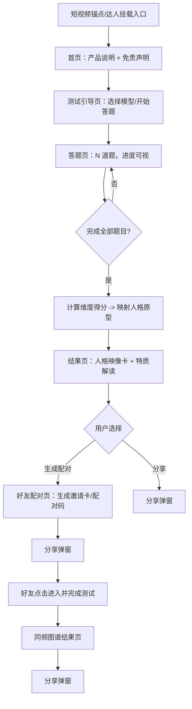

# 项目需求说明书（PRD）
## 星语人格 · 好友同频测试（暂定名）

| 项目 | 内容 |
|---|---|
| 文档类型 | 立项评审用产品需求说明书 |
| 产品形态 | 抖音小程序（测试类轻量小游戏，即点即玩） |
| 产品性质 | 趣味叙事娱乐测试；**非专业心理测评、非占卜算命工具** |
| 赛道定位 | 心理学人格测试 × 好友/闺蜜人格配对 × 占星·塔罗·天体图像符号 |
| 评审对象 | 研发、美术、文案、运营（达人/发行人） |
| 文档版本 | v1.9（题库、原型解读、5 档相处模式解读、研发侧技术方案预研、测试验收方案、上线计划与运营节奏已交付） |

> **阅读约定**：全文以 `【产品功能】` 标注需工程实现的机制与规则，以 `【内容叙事】` 标注由文案/美术产出的解读、命名、图像与文案素材。两者需分别排期、分别验收。
>
> **总风控前提（适用于全部章节）**：本产品为趣味娱乐测试，结果用于社交话题与自我表达叙事，不作为专业心理诊断依据，不预测命运、不测算吉凶、不做运势推断。所有页面必须常驻免责声明（见第 8 章）。

---

## 1. 项目概述

### 1.1 项目名称
- 产品名（暂定）：《星语人格 · 好友同频测试》
- 内部代号：StarType
- 一句话介绍：3 分钟完成一次人格映像测试，点亮独属于你的人格原型符号卡，再邀请好友生成一张"同频图谱"。

### 1.2 产品定位
`【产品功能】`
- **形态**：抖音小程序内即点即玩的测试类小游戏，单次完整流程目标 ≤ 3 分钟。
- **入口**：以短视频锚点挂载为主入口，达人内容引流为增长入口。
- **内容性质**：以"人格原型 + 人际相处模式 + 符号意象"为叙事外壳的娱乐测试，**不构成心理诊断、不做命理推断**。

### 1.3 目标用户
| 用户群 | 画像描述 | 核心诉求 |
|---|---|---|
| 主力用户 | 18–30 岁，以女性为主，短视频重度用户，关注 MBTI/性格话题、闺蜜日常、星空美学 | 自我标签化表达、获得可分享的社交货币 |
| 传播用户（达人） | 情感/心理/星座/颜值类中腰尾部达人，需要高互动、高完播的内容选题 | 内容钩子、粉丝互动率、挂载转化 |
| 配对发起者 | 完成测试后主动邀请好友/闺蜜的用户 | 拉人配对、验证"我们像不像" |

### 1.4 核心价值
`【产品功能】`
- **低门槛**：无需注册账号即可开局，进入即答题，降低跳出。
- **强社交钩子**：以"好友配对"作为核心而非附属玩法，把单次自测转化为双人互动。
- **可复玩**：人格原型固定但"配对对象"可变，用户可对不同好友反复生成图谱。

`【内容叙事】`
- **表达价值**：把泛化的性格描述转化为可截屏、可分享的"人格映像卡"与"同频图谱"。

### 1.5 产品差异化亮点
1. **三重意象叠加**：人格原型（叙事） × 人际同频（社交） × 星象符号（视觉），三层各司其职，不越界。
2. **以配对为核心机制**：多数同类测试止步于单人结果，本产品把"邀请好友"设计进主流程。
3. **符号卡牌化视觉资产**：以原创天体/符号卡面替代写实占卜牌，形成可延展的视觉 IP。
4. **合规优先的叙事口径**：用"特质/偏好/原型/相处模式"替代一切命理与预测表达（见第 4、8 章）。

---

## 2. 市场与竞品简述

> 本章用于立项判断，不参与功能验收。涉及具体市场数字的结论均标注为待核实项。

### 2.1 赛道机会
- 测试类内容天然适配短视频：**结果可视化 + 身份标签化**，用户在评论区自发讨论结果，形成二次传播。
- "闺蜜/好友"关系类话题与"性格标签"话题在抖音具备长期内容供给，达人选题成本低、可复用。
- 星象/塔罗类视觉在年轻用户中具备审美吸引力，但**占卜预测类表述存在明显合规风险**，存在以"符号意象化"承接该审美需求的差异化空间。

### 2.2 同类产品优缺点
| 类型 | 优点 | 缺点 | 可借鉴 / 需规避 |
|---|---|---|---|
| MBTI 风格人格测试 | 结果体系完整、用户认同感强 | 题库冗长、娱乐性弱、结果缺乏视觉记忆点 | 借鉴维度化结果结构；规避"专业量表"表述 |
| 星座/塔罗类测试 | 视觉与神秘感强、传播意愿高 | 涉及运势/预测表述，合规风险高；结果同质化 | 借鉴视觉语言；**明确禁止**运势预测类输出 |
| 好友/闺蜜配对测试 | 社交裂变强、互动率高 | 配对逻辑黑盒、结果单薄、复玩率低 | 强化配对结果的可解释叙事与可复玩性 |

### 2.3 本项目差异化
- 以"原型叙事 + 符号意象"承接神秘美学，但**不涉及任何吉凶、运势、命运推断**。
- 配对结果给出"相处模式"叙事（如互补型、共振型），而非简单评分排名。
- 结果卡具备强视觉资产，可直接用于短视频封面与好友邀请。

---

## 3. 核心玩法设计

### 3.1 主流程
`【产品功能】`

**关键节点定义**
- **开局条件**：用户从入口进入小程序，无需登录即可答题。
- **完成条件**：答完全部题目 → 系统输出人格原型结果（用户可见"人格映像卡"，即视为本次任务完成）。
- **恢复路径**：答题中途退出后再次进入，若存在未完成会话则提示"继续上次答题"，从上次进度恢复（见 3.6）。

### 3.2 测试机制
`【产品功能】`
- **题目规模**：单次测试题目 10 题（已确认），每题 2–4 个选项；题库与选项权重表见配套资产《文案资产-10题题库与计分表.md》。
- **维度模型**：采用 4 个内在特质维度，每维度两端为对立描述，内部命名见下方「维度内部命名」。
- **计分规则**：每题 2 个选项、二选一；被选中的选项为其所属维度的对应端点 **+1 分**（每题仅归属 1 个维度，权重固定为 1）。答题结束后取各维度得分较高的一端为主导端，组合映射到人格原型。选项权重表见《文案资产-10题题库与计分表.md》，研发以该表为准。
- **映射规则**：按 D1→D4 顺序取各维度端点代号（A/B）拼成 4 位原型码，每个码位对应 1 个原型，共 **16 个原型**（已确认）。每个原型有唯一 ID、原型名、符号卡面、特质解读文本。
- **同分处理**：维度两端同分时默认取该维度 A 端，规则全局唯一定义（见 3.5）。
- **结果确定性**：同一用户在同一测试版本内重复作答，若答案一致，结果必须一致（无随机成分）。

**维度内部命名（已确认）**

| 代号 | 维度 | 端点 A | 端点 B |
|---|---|---|---|
| D1 | 表达取向 | 外显 | 内隐 |
| D2 | 能量取向 | 炽放 | 静蓄 |
| D3 | 决策取向 | 理性 | 感性 |
| D4 | 关系取向 | 主动 | 随和 |

**原型码规则（已确认）**：原型 ID = D1–D4 端点代号顺序拼接，如 A-B-A-B 记为 `ABAB`；共 16 个码位，码位与原型名一一对应（原型名清单见 4.1，由文案产出）。

`【内容叙事】`
- 题目文案、选项文案、人格原型名与解读文本均为文案资产，见第 4 章。
- **重要口径**：本维度模型为**娱乐化叙事模型**，不得对外表述为专业心理量表或临床测评工具。

### 3.3 好友配对逻辑
`【产品功能】`
- **发起**：用户在结果页点击"邀请好友配对"，生成一条带唯一配对码的邀请卡/分享链接。
- **加入**：好友通过链接进入，完成本人测试后自动与发起者完成配对。
- **配对计算**：基于双方 4 个维度结果，按"同频度"规则计算（规则见 3.5「同频度模型」，全局唯一定义），输出 1 个"相处模式"标签与同频图谱。
- **配对结果元素**：双方人格原型、同频图谱（维度对照可视化）、相处模式叙事文本（**5 档解读文案见《文案资产-5档相处模式解读.md》**）。
- **边界与状态**：
  - 单人完成、对方未完成 → 配对页状态为"等待对方完成"，展示等待提示与再次分享入口。
  - 邀请链接有效期 7 天（已确认），过期后提示重新发起。
  - 同一用户对同一好友重复配对 → 复用已有配对结果，不重复计算；不同好友各自独立配对。

### 3.4 内容分层说明（功能 vs 叙事）
| 层 | 归属 | 产出方 | 示例 |
|---|---|---|---|
| 流程/计分/配对算法 | 【产品功能】 | 研发 + 产品 | 维度计分、同频度计算、状态机 |
| 题面/选项文案 | 【内容叙事】 | 文案 | 题干与选项措辞 |
| 人格原型名与解读 | 【内容叙事】 | 文案 | 原型命名、特质文本 |
| 符号卡面/星象意象 | 【内容叙事】 | 美术 | 卡牌、天体图形、动效 |
| 免责声明与合规口径 | 【产品功能】 | 产品 + 法务 | 页面固定区域 + 全局词表 |

### 3.5 共享规则（全局唯一定义）
`【产品功能】`
- **角色与权限**：本产品无注册体系；"发起者"与"受邀者"仅由配对关系区分，二者权限对等。
- **对象状态机**：
  | 对象 | 状态 | 说明 |
  |---|---|---|
  | 测试会话 | 未开始 / 进行中 / 已完成 | 决定是否展示"继续上次答题" |
  | 配对邀请 | 待接受 / 已完成 / 已过期 | 决定配对页展示内容 |
- **计算规则**：维度计分、原型映射、同频度计算均需单一权威实现，前端与后端不得各自重算。
- **同分判定**：某维度两端同分时，默认取该维度的 A 端（外显 / 炽放 / 理性 / 主动）；A 端与 B 端仅为分类代号，**不代表优劣**。按题库分布（D1×3 / D2×3 / D3×2 / D4×2），同分仅可能出现于 D3、D4。

**同频度模型（确认稿，全局唯一定义）**
- 对 4 个维度逐维对比，结果仅两种：**一致**（双方同端）或**互补**（双方异端）。
- 记一致项数 C、互补项数 P，恒有 C + P = 4。
- 展示值：同频度 = (C × 3 + P × 2) ÷ 12 × 100%（满分 12）。权重 3 / 2 为可调参数，仅用于展示百分比，**不参与标签判定**。
- 相处模式标签按 C 值映射，不按百分比排名，保证结果稳定可读：

  | C | 相处模式标签 | 叙事方向 |
  |---|---|---|
  | 4 | 同频共振型 | 高度相似，默契同频 |
  | 3 | 高默契型 | 三处同频，一处互补 |
  | 2 | 均衡互补型 | 同频与互补各半 |
  | 1 | 差异互补型 | 以差异形成互补 |
  | 0 | 极致互补型 | 处处不同，互为补充 |

  > 本表为标签与档位映射的**唯一权威**；各档的叙述文案见《文案资产-5档相处模式解读.md》，文案不得新增或改写标签。

### 3.6 异常与边界
`【产品功能】`
| 场景 | 处理 |
|---|---|
| 答题中途退出 | 保留会话进度，再次进入提示继续 |
| 网络中断导致提交失败 | 结果页展示重试入口，重试幂等（不产生重复结果） |
| 邀请链接失效/过期 | 提示过期并提供重新发起入口 |
| 受邀者未完成测试 | 发起者侧展示等待状态，可再次提醒分享 |
| 同一会话重复进入结果页 | 结果以首次计算结果为准，不重新随机 |

---

## 4. 内容与文案规范

> 本章为【内容叙事】主责章节。所有文案与图像素材须通过本章口径检查后方可上线。

### 4.1 人格结果解读风格
`【内容叙事】`
- **人称**：第二人称（"你倾向于……"），营造对话感。
- **语气**：描述性、肯定但不绝对；避免命令式与判定式表达。
- **句式模板**：`你倾向于【特质描述】，在【场景】中更容易表现出【行为倾向】。`
- **结构要求**：每个原型解读包含：① 一句话原型概述 ② 3 条特质描述 ③ 1 条相处模式提示 ④ 免责提示。
- **禁止**：对用户下定义式判断（如"你就是……性格有问题"）、负面羞辱性描述、任何形式的因果断言。

**人格原型库清单（16 个，提案稿 · 文案可微调名称）**

| 原型码 | 原型名 | 主导意象 |
|---|---|---|
| AAAA | 曜日型 | 正午恒星 |
| AAAB | 日珥型 | 恒星烈焰边缘 |
| AABA | 彗尾型 | 掠过的彗星轨迹 |
| AABB | 极光型 | 高空光帘 |
| ABAA | 晨星型 | 破晓启明星 |
| ABAB | 双星型 | 相互环绕的双星 |
| ABBA | 潮汐型 | 被牵引的海面 |
| ABBB | 深海型 | 深水中的暗流 |
| BAAA | 星芒型 | 单颗高亮恒星 |
| BAAB | 星雾型 | 弥漫的星云薄雾 |
| BABA | 月晕型 | 安静月轮光晕 |
| BABB | 星砂型 | 缓慢漂移的星尘 |
| BBAA | 极星型 | 恒定的坐标星 |
| BBAB | 萤火型 | 深空里的微光 |
| BBBA | 静湖型 | 倒映星空的湖面 |
| BBBB | 夜幕型 | 静谧的深夜穹顶 |

**命名体系**：原型名 = 意象词 + 「型」；意象词仅取自符号元素库，**不得含吉凶、运势、预言类语义**（见 4.2 / 4.3）。

**原型解读文案**：16 个原型的完整解读文案（① 一句话概述 ② 3 条特质描述 ③ 相处模式提示 ④ 免责提示）见配套资产文件《文案资产-16人格原型解读.md》，文案按该模板产出并按校对清单验收。

### 4.2 占星 / 塔罗 / 天体意象使用规范
`【内容叙事】`
- **允许用途**：仅作为**图像符号与原型叙事素材**——卡面图形、符号命名、意象化文案。
- **表达边界**：
  - 可以写："这张符号卡呈现的是【意象描述】"。
  - 不得写：任何将天体、星象与个人命运、运势、吉凶建立关联的表述。
- **图像规范**：使用原创绘制的符号/天体/卡牌视觉，不得直接使用真实占卜牌的完整版式与宗教性标识；不得出现"预测、推算、开运"类视觉字样。

### 4.3 专用词表（全站强制）
`【产品功能】`（词表校验）+ `【内容叙事】`（文案创作遵循）

**禁用词**（全文、全部文案、视觉文字、分享卡、评论区引导文案均适用）：
`命中注定`、`一定会`、`宿命`、`吉凶`、`预言`、`转运`、`算命`、`预测未来`

**推荐词**：`特质`、`偏好`、`原型`、`性格倾向`、`相处模式`、`气质意象`

**执行要求**：
- 上线前对全部文案做一次词表扫描，命中禁用词即阻断发布。
- 视觉文字（卡面、印章、标题字）同样纳入扫描范围。

### 4.4 免责文案（统一模板）
`【产品功能】`（位置与常驻）+ `【内容叙事】`（措辞）

| 位置 | 文案 |
|---|---|
| 首页（常驻，非弹窗） | 本测试为趣味娱乐内容，结果依据你的主观作答生成，仅供娱乐与社交互动参考；不构成心理学专业测评、心理诊断或咨询建议，也不构成任何形式的命运、运势或未来推断。 |
| 测试引导页（底部常驻） | 本测试为趣味娱乐内容，结果仅供娱乐参考；不构成心理学专业测评、心理诊断或咨询建议，也不构成任何形式的命运、运势或未来推断。 |
| 答题页（底部弱提示） | 请凭第一感受作答，结果仅供娱乐参考。 |
| 结果页（结果卡下方） | 本结果基于趣味叙事模型生成，仅供娱乐，不作为心理诊断或专业测评依据。 |
| 配对页 / 同频图谱 | 同频度为娱乐化叙事指标，仅反映双方作答的相似与互补，仅供社交互动参考。 |
| 分享弹窗 / 分享卡 | 娱乐测试 · 结果仅供参考 |

**要求**：免责声明在全部页面常驻可见，不得通过折叠、超小字号或仅弹窗一次的方式隐藏。
**签署**：以上措辞为法务复核稿，经法务签核后冻结；若法务调整措辞，以签核版本为准。

---

## 5. UI 美术需求

> 本章为【内容叙事】主责章节（美术资产），其中标注为功能的部分由研发实现。

### 5.1 视觉风格
`【内容叙事】`
- **关键词**：星空、天体符号、塔罗卡面意象、神秘符号、微光质感。
- **调性**：静谧、神秘但柔和不阴郁；避免恐怖、宗教禁忌、写实占卜场景。
- **材质与光效**：星空渐变底、细金线描符号、卡牌金属烫边感、粒子微光。

### 5.2 视觉规范
| 项 | 要求 |
|---|---|
| 主色 | 深空蓝紫主底 `#1B1035`、次级底 `#2A1B4A`、暖金线条 `#E8C87A`、象牙白文字 `#F5EFE6`、星芒淡紫点缀 `#C9B6FF`；背景渐变 135° 由 `#1B1035` → `#3A2A6B`（色值已确认） |
| 字体 | 标题（神秘感衬线/手写体）：霞鹜文楷 LXGW WenKai；正文（高可读无衬线）：思源黑体 Source Han Sans / 阿里巴巴普惠体。**三者经检索均为 OFL / 免费商用授权且允许捆绑分发，仍须法务复核版权声明保留与保留字体名称条款**（来源见《平台规则检索记录.md》R-6） |
| 图形资产 | 人格原型卡（每原型 1 张）、符号元素库、天体装饰元素、配对图谱模板；**线稿说明见《美术资产-全流程视觉P01-P06线稿说明.md》，全流程设计稿见《美术稿-全流程视觉-P01-P06.html》（已导出同名 PNG），16 原型符号见《美术稿-原型符号库.html》（已导出同名 PNG），通用装饰元素见《美术稿-通用装饰元素库.html》（已导出同名 PNG），UI 功能图标见《美术稿-功能图标库.html》（已导出同名 PNG，含 20 图标与替换指引）** |
| 动效 | 卡面翻牌、星点聚合成图谱、结果揭晓光晕；控制在低端机可流畅运行 |
| 禁止元素 | 真实占卜牌完整版式、宗教符号误用、吉凶/运势类文字、血腥恐怖元素 |

### 5.3 技术适配
`【产品功能】`
- **适配**：小程序仅支持竖屏（平台不支持横屏配置）；单位采用 rpx（平台原生响应式单位，按屏幕宽度自适应换算）；覆盖主流机型安全区。
- **性能**：按平台分包限制控制资源——主包 ≤ 4M、单个分包 ≤ 2M、全部分包合计 ≤ 16M、同一分包内预下载共享 2M 限额；动效在低端机型降级为静态卡面。
- **资源管理**：符号与卡面资源按需加载并优先放入分包，避免主包过大影响启动与完测率。
- **研发实施方案**：技术选型（抖音原生小程序 + Serverless 云函数）、计分与映射、同频度、配对状态机、会话幂等、接口契约、埋点落点、包体积与字体子集化策略的可执行详设见《技术资产-研发侧技术方案预研.md》。其中**计分与同频度仅在服务端实现一次**，与 3.5「单一权威实现」一致，前端不得存在实现副本。

> 上述限制为检索所得（来源见《平台规则检索记录.md》R-1、R-2），提审前须比对官方文档原文。另有「包体积 ≤ 8M」的表述出现在资源加载类文档，与分包口径不同，须按具体能力分别复核。

---

## 6. 核心页面清单

`【产品功能】` 以下为功能页面定义；各页文案与视觉为 `【内容叙事】`。

| 页面 ID | 页面 | 目的 | 关键元素 | 免责位置 |
|---|---|---|---|---|
| P-01 | 首页 | 说明产品、承接流量、引导开局 | 一句话介绍、开始测试按钮、免责声明常驻、赛道意象视觉 | 页面底部常驻 |
| P-02 | 测试引导页 | 明确玩法与作答方式 | 玩法三步骤说明、预计时长、开始答题按钮 | 页面底部常驻 |
| P-03 | 答题页 | 完成题目作答 | 进度条、题干、选项、上一题、作答即进入下一题 | 底部弱提示 |
| P-04 | 结果页 | 输出人格映像卡与解读 | 原型符号卡、原型名、特质解读、配对入口、分享入口 | 结果卡下方 |
| P-05 | 好友配对页 | 发起/完成配对并展示图谱 | 邀请卡与配对码、等待状态、同频图谱、相处模式叙事 | 页面底部常驻 |
| P-06 | 分享弹窗 | 完成分享动作 | 分享卡预览、分享渠道（抖音好友 / 抖音群 / 保存图片 / 复制配对码）、再次配对入口 | 分享卡内文字 + 弹窗底部各常驻一次 |

**视觉交付现状**
- **P-01 → P-06 全流程视觉设计稿**已交付：《美术稿-全流程视觉-P01-P06.html》（含同名 PNG 导出版），覆盖首页、测试引导页、答题页、结果卡（竖版 + 方形分享卡 + 计算中 / 计算失败）、配对图谱（已完成 / 等待 / 已过期）、分享弹窗，共 10 个视图。
- **线稿说明**见《美术资产-全流程视觉P01-P06线稿说明.md》，已覆盖 P-01 → P-06 全部页面（含逐页线稿、元素清单、规格值、状态与边界）。本章页面清单已全部出稿收口。

**流程型状态补充**
- P-05 需覆盖三种状态：等待对方完成 / 配对完成 / 邀请已过期。
- P-04 需覆盖"计算中"加载态与"计算失败可重试"态。

---

## 7. 分发与商业化设计

### 7.1 流量分发
`【产品功能】`（技术挂载）+ `【内容叙事】`（达人脚本）
- **短视频锚点挂载**：小程序锚点挂在达人短视频下方，用户点击即进入首页 P-01。
- **达人推广挂载与小程序推广计划**：面向情感/心理/星座/颜值类中腰尾部达人，通过小程序任务台发布推广任务，达人接单投稿并挂载小程序。**开通前置**：小程序信用分 ≥ 60 分、主营类目符合平台开放的达人推广挂载类目、须签署《小程序任务台推广协议》。分成与结算细则 `[TBD，按平台当期政策]`。
- **更正说明**：本条原表述为「发行人计划」。经检索，游戏发行人计划文档归属**小游戏**（mini-game）；小程序侧对应通路为「短视频达人推广挂载 + 小程序推广计划 / 任务台」，故更正（来源见《平台规则检索记录.md》R-4）。
- **达人素材方向**：【内容叙事】达人拍摄"测试自己的结果 + 拉闺蜜配对"的过程型短视频，钩子置于前 3 秒；**钩子模板、口播脚本、分镜建议、挂载对应与上线校验清单见《文案资产-达人引流素材规范.md》**。

### 7.2 分享裂变
`【产品功能】`
- 结果页与配对页均提供分享卡生成能力；分享卡包含用户人格原型与邀请配对码。
- 分享通过抖音小程序转发能力实现；**不得使用强制分享、诱导分享、分享后解锁等违规手段**。
- **分享渠道（已确认 4 项）**：抖音好友、抖音群、保存图片、复制配对码；渠道实际可用性以抖音小程序分享能力为准（见 5.3 技术适配）。
- 分享回流：好友点击分享卡落地到 P-01 或直接进入配对流程。

### 7.3 变现方式
`【产品功能】`
- **主变现**（已确认）：激励视频 1 处（自愿触发，用于"查看完整解读""解锁第二个原型维度"等自愿行为）+ 结果页原生广告位（信息流位）1 处。**前置**：须先在控制台「设置 → 商业化变现」开通流量主（准入为无严重违规行为）；**仅线上状态的小程序调用广告才产生收益**（来源见《平台规则检索记录.md》R-5）。
- **次变现**：可选虚拟内容（如额外符号卡主题包）——**列为不承诺项，不纳入本期范围**（虚拟支付资质与审核要求随平台规则另行评估）。
- **合规约束**：广告不得伪装为测试结果或功能按钮；不得以"改变结果"为诱导条件（不提供"付费改运"类能力，该能力本身即违反内容红线）。

---

## 8. 平台合规 & 风控需求

> 提审前的逐项自检、材料截图清单与红线速查（一票否决项）见《合规资产-提审自检清单.md》。

### 8.1 抖音小程序审核要点
`【产品功能】` + 合规（法务/运营把关）
- 类目与资质：目标类目方向为**工具 → 娱乐工具**（平台设有《娱乐工具行业运营规范》，适用于该类目下全量小程序）；准入包含类目资质（《企业主体开放服务类目》）、保证金（《小程序保证金管理规范》）与主体认证。本期不涉及虚拟支付。来源见《平台规则检索记录.md》R-3，提审前须按官方类目表复核。
- 内容自查：提交审核前完成对全部文案与视觉素材的禁用词扫描。
- 未成年人保护：不设置任何付费抽奖、诱导充值链路。
- 真实描述：小程序简介与实际功能一致，不得宣称"专业心理测评""精准测算"。

### 8.2 强制免责声明
- 全部页面常驻免责声明（见 4.4 模板），此为实现层强制项，验收时逐页核对。
- 分享卡、达人挂载文案同样包含"娱乐测试"标识。

### 8.3 内容红线
| 红线 | 具体要求 |
|---|---|
| 命理与预测 | 禁止任何命运预测、吉凶判断、运势推断、开运转运表述 |
| 专业冒充 | 禁止宣称专业心理测评、临床诊断、心理咨询能力 |
| 绝对化表达 | 禁止使用"命中注定、一定会、宿命"等词表内禁用词 |
| 迷信引导 | 禁止以天体/星象建立对个人命运的影响关系 |
| 诱导分享 | 禁止强制分享、分享解锁、诱导裂变话术 |
| 视觉红线 | 禁止真实占卜牌版式、宗教符号误用、恐怖血腥元素 |

---

## 9. 项目验收指标

> 目标数值需结合首发投放数据校准，未确定处标注 `[TBD]`，不预先虚构目标。

`【产品功能】` 指标定义与埋点口径：

| 指标 | 定义 | 计算方式 | 目标值 |
|---|---|---|---|
| 完测率 | 完成全部题目并生成结果的比例 | 生成结果 UV / 进入答题页 UV | [TBD] |
| 分享率 | 完成结果后触发分享的比例 | 分享行为 UV / 结果页 UV | [TBD] |
| 停留时长 | 单次会话在小程序内的平均时长 | 会话总时长 / 会话数 | [TBD] |
| 配对发起率 | 结果页进入配对流程的比例 | 配对页进入 UV / 结果页 UV | [TBD] |
| 配对完成率 | 发起后对方完成并生成图谱的比例 | 配对完成 UV / 配对发起 UV | [TBD] |
| 次留/复访 | 次日回访比例 | 次日回访 UV / 当日新增 UV | [TBD] |

**验收口径补充**
- 完测率为首要健康指标：单次流程时长、首包体积、答题页交互复杂度均以其为目标约束。
- 分享率与配对完成率反映裂变效率，需联动评估分享卡视觉点击表现。
- 事件名与上报字段定义（已确认）见下表；所有事件均携带公共字段：`session_id`、`user_pseudo_id`（脱敏标识）、`app_version`、`quiz_version`、`ts`、`network`。

**埋点事件表（已确认）**

| 事件名 | 触发时机 | 专属字段 |
|---|---|---|
| `page_view` | 任一页面进入 | `page_id`、`entry_source` |
| `test_start` | 点击开始答题 | `entry_source` |
| `answer_submit` | 每次提交答案 | `question_id`、`option_id`、`question_index`、`elapsed_ms` |
| `test_complete` | 生成人格结果 | `archetype_id`、`total_duration_ms`、`answer_count` |
| `result_view` | 结果页展示 | `archetype_id`、`is_revisit` |
| `pair_invite_create` | 生成配对邀请 | `pair_code`、`archetype_id` |
| `pair_invite_accept` | 受邀者接受邀请 | `pair_code` |
| `pair_complete` | 同频图谱生成 | `pair_code`、`c_count`、`band_label`、`similarity_pct` |
| `share_click` | 触发分享 | `scene`（result / pair）、`channel` |
| `ad_impression` | 广告曝光 | `ad_type`、`placement` |
| `ad_reward` | 激励视频完播 | `ad_type`、`placement`、`ad_scene` |
| `session_end` | 会话结束 | `duration_ms`、`page_count` |

**指标换算口径**：完测率 = `test_complete` ÷ `page_view`(page_id = P-03)；分享率 = `share_click` ÷ `result_view`；停留时长取 `session_end.duration_ms` 均值。

**验收方法**：上表指标口径的可执行验证步骤、功能与异常用例、配对状态机并发与幂等专项、兼容与性能测试矩阵、红线合规实现层 12 项验收，见《测试资产-验收用例与测试计划.md》。性能阈值与目标值在该资产中同样保留 `[TBD]`，不预先虚构。

---

## 10. 立项决策清单（建议方案已采纳）

> 本章建议方案已于立项评审采纳并生效，对应取值已回写至关联章节。原 10.4 遗留事项已补齐，见 10.4。全文仍挂 `[TBD]` 的仅为：随抖音平台规则确认的条目（技术适配规范、发行人结算政策）与待首发数据校准的指标目标值。凡涉及金额、资质与合规的条目，以最终确认结果为准。

### 10.1 P0 阻塞研发（已确认，可启动）

| 编号 | 确认项 | 确认方案 | 关联章节 | 责任方 | 遗留子项 / 状态 |
|---|---|---|---|---|---|
| Q1 | 人格维度模型与原型库 | 采用 4 个内在特质维度；原型数量与命名由文案提案报批 | 3.2 / 4.1 / 5.2 | 产品 + 文案 | 已补齐，见 3.2 |
| Q2 | 题目数量与单次测试时长 | 10 题；单次完整流程目标 ≤ 3 分钟 | 3.2 / 9 | 产品 + 文案 | 已补齐，见题库资产 |
| Q3 | 配对邀请有效期与同频度规则 | 邀请有效期 7 天；同频度 = 维度一致项加权 + 互补项加权 | 3.3 / 3.5 | 产品 + 研发 | 已补齐，见 3.5 |
| Q4 | 抖音小程序类目与虚拟支付资质 | 选择娱乐测试类目；虚拟内容变现列为不承诺项 | 7.3 / 8.1 | 运营 + 法务 | 平台最新审核规则最终复核 |

### 10.2 P1 可并行推进（已确认，随研发并行落地）

| 编号 | 确认项 | 确认方案 | 关联章节 | 责任方 | 遗留子项 / 状态 |
|---|---|---|---|---|---|
| Q5 | 视觉主色板与字体授权 | 深蓝紫星空底 + 暖金线条；字库须可商用授权 | 5.1 / 5.2 | 美术 + 法务 | 已补齐，见 5.2 |
| Q6 | 广告位数量与展示时机 | 激励视频 1 处（自愿触发）+ 结果页原生广告位 1 处 | 7.3 / 9 | 产品 + 运营 | 广告位埋点与展示时机细化 |

### 10.3 研发启动后执行顺序

1. **Q1 派生工作优先**：文案基于 4.1 原型清单（16 个）产出解读文本与题库，同步锁定选项权重。
2. **Q3 派生工作并行**：研发实现配对算法与配对状态机，同频度规则以 3.5 为准。
3. **Q4 由运营与法务并行复核**：不影响主流程开发，但影响变现方案与上线排期。
4. **Q5、Q6 在研发期间并行落地**：属体验与资产层。

### 10.4 遗留待补充事项（已补齐）

| 事项 | 补齐结果 | 落地位置 | 状态 |
|---|---|---|---|
| 维度内部命名与人格原型库 | D1–D4 内部命名确认；原型库 16 个；原型码 = D1–D4 端点代号拼接；16 个原型名与主导意象已列 | 3.2 / 4.1 | 已补齐 |
| 同频度计算规则 | 一致项 C / 互补项 P，C + P = 4；展示值 = (C×3 + P×2) ÷ 12；标签按 C 值映射 | 3.5 / 3.3 | 已补齐 |
| 视觉色值与字库 | 5 个色值 + 135° 渐变确认；标题霞鹜文楷、正文思源黑体 / 阿里巴巴普惠体 | 5.2 | 已补齐（字体授权待法务复核） |
| 埋点事件名与字段 | 12 个事件 + 公共字段 + 指标换算口径 | 第 9 章 | 已补齐 |
| 免责声明措辞 | 6 处页面措辞定稿 | 4.4 | 待法务签核 |

**另**：题库定稿与选项权重表已在配套资产《文案资产-10题题库与计分表.md》补齐（原属 10.1 Q2 遗留子项，不在 10.4 的 5 项范围内）。

### 10.5 外部依赖（待确认，不阻塞研发启动）

需外部信息才能定稿的条目已独立为台账，含确认渠道、临时并行策略与回写点：

| 类别 | 条目 | 主责 | 检索状态 |
|---|---|---|---|
| ① 平台规范类 | D-1 技术适配（5.3）、D-2 类目与资质（8.1）、D-7 广告变现准入（7.3） | 研发 / 产品 | 已检索到参考值，待平台侧复核 |
| ② 商业政策类 | D-3 达人推广挂载与结算政策（7.1） | 商务运营 | 已检索到机制口径，分成与结算细则待平台侧确认 |
| ③ 数据类 | D-4 指标目标值（第 9 章） | 产品 | 无外部来源，待首发数据校准 |
| ④ 法务类 | D-5 免责措辞（4.4）、D-6 字库授权（5.2） | 法务 | D-6 已检索到授权结论，条款细节待法务判定 |

检索明细与来源见《平台规则检索记录.md》（检索日期 2026-10-16，**未经平台侧确认**）；派工、并行策略与回写点见《待确认项台账-外部依赖确认单.md》。**检索值不等于确认值**，提审前须比对官方文档原文并以平台侧答复为准。

**配套资产总览**：本文档的立项评审汇总稿（单页 HTML，含主流程图、题库维度分布、同频度档位映射三张图）见《立项汇报稿-星语人格/立项汇报稿-星语人格.html》；研发可直接开工的实现口径见《技术资产-研发侧技术方案预研.md》；验收与测试口径见《测试资产-验收用例与测试计划.md》；阶段划分、里程碑出口准则、灰度首发与达人投放节奏见《运营资产-上线计划与运营节奏.md》。内容口径以本文档 v1.9 为准。

---

*本文档为 v1.9。本版新增：《运营资产-上线计划与运营节奏.md》（阶段划分、里程碑出口准则、灰度与首发、达人投放与变现开通节奏、监控复盘口径，已挂至 10.5）。v1.8 新增《测试资产-验收用例与测试计划.md》；v1.7 新增《技术资产-研发侧技术方案预研.md》；v1.6 已按《平台规则检索记录.md》（检索日期 2026-10-16）回填 5.2 字库授权、5.3 技术适配、7.1 分发通路、7.3 广告准入、8.1 类目与资质；其中 7.1 由「发行人计划」更正为「达人推广挂载 + 小程序推广计划」。检索值未经平台侧确认，提审前须复核。全文内容口径须符合第 4、8 章风控规则。*
