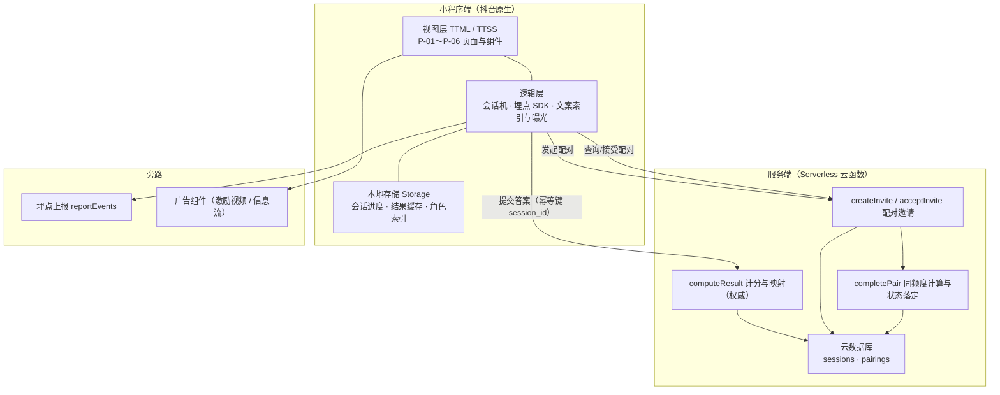

# 技术方案预研：研发侧实施方案
## 《星语人格 · 好友同频测试》配套资产

| 项目 | 内容 |
|---|---|
| 文档类型 | 研发侧技术方案预研（立项后、开工前） |
| 上游依据 | 《PRD-抖音趣味测试小游戏-星语人格.md》（第 3 / 5.3 / 6 / 7 / 9 章为强约束）；《文案资产-10题题库与计分表.md》；《平台规则检索记录.md》（R-1～R-7） |
| 读者 | 前端 / 服务端 / 数据 / 测试 / 美术（切图交付口径） |
| 文档版本 | v1.1（新增 4.1 字体子集化方案与字符集实测） |
| 状态 | 预研结论 + 可执行详设（3.1～3.5 核心链路、4.1 字体子集化）；其余模块为预研级结论 |

> **阅读约定**：沿用 PRD 口径，`【决策】` 为本次已定选型，`【详设】` 为可直接开工的实现细节，`【预研】` 为结论级要点，`【待复核】` 为依赖外部信息的条目（编号沿用 PRD 10.5 的 D-1～D-7，另见《待确认项台账-外部依赖确认单.md》）。
>
> **数值原则**：凡平台能力、配额、性能阈值均标注来源编号；**检索值不等于确认值**（检索日期 2026-10-16）。无外部来源的数值一律不预填，标注 `[TBD]`。

---

## 0. 总结论

1. **链路可闭环**：PRD 定义的 16 原型、10 题计分、同频度模型、配对状态机均可用纯函数实现，无随机成分，可 100% 单元测试覆盖（含 2¹⁰ = 1024 组合穷举校验）。
2. **技术风险集中在三处**：① 跨用户配对必须依赖服务端，服务端形态待定（`【待复核】`）；② 字体体积与包体积上限的冲突（**已落成子集化方案与字符集实测，见 4.1**）；③ 平台分享场景与落地路由参数的可用性（`【待复核】`）。
3. **合规可落到代码层**：禁用词扫描、免责常驻（≥24rpx、不得折叠）、广告不得伪装为结果，均可在构建期或组件层强制，不依赖人工自觉。
4. **不阻塞开工**：本文全部核心链路（第 3 章）不依赖任何外部确认项，可即刻排期；受外部依赖影响的仅为服务端载体、广告接入、分包上限口径三处。

---

## 1. 技术选型与决策记录

### 1.1 选型结论

| 层 | `【决策】` 选型 | 理由 | 备选（未采纳） |
|---|---|---|---|
| 前端 | **抖音原生小程序**（TTML / TTSS / JS） | 单端产品，无跨端诉求；原生直用平台最新能力（分享、激励视频、分包预下载），包体积与首屏最可控，与 PRD 5.3 分包约束最契合 | Taro / uni-app：引入适配层开销，包体积与低端机性能风险更高，收益仅在未来跨端 |
| 后端 | **Serverless 云函数** | 配对码生成、配对计算、埋点转发均为低频轻逻辑，无需常驻服务；无注册体系下鉴权链路最短，免运维 | 自建后端：需自建登录态、鉴权、运维与安全，本期体量不匹配 |
| 数据存储 | **云数据库（文档型）** | 与云函数同平台、免运维；配对关系数据量小、结构简单，无需关系型 | 自建 MySQL：本期无复杂事务与统计诉求 |
| 计算归属 | **单一权威实现** | PRD 3.5 强制「前端与后端不得各自重算」 | 前后端双实现：会产生口径漂移，明确禁止 |
| 状态存储 | 本地 Storage（会话/结果）+ 云端（配对关系） | 单人链路可离线完成，减少服务端依赖 | 全云端：增加失败面，降低完测率 |

`【待复核】` **服务端载体的具体产品形态**（平台官方 Serverless / 云托管 / 第三方云函数）**与免费额度、配额、并发限制**：属 D-1（技术适配）与 D-7（变现准入）范畴，须按平台侧文档原文复核。本文第 3、5、6 章的接口契约与数据模型与具体载体无关，选型变更不影响其有效性。

### 1.2 计算权威归属（关键决策）

> **人格结果与同频度计算仅在服务端实现一次**；前端不做独立实现、不做本地预演，严格遵循 PRD 3.5「单一权威实现，前端与后端不得各自重算」。P-04 的「计算中」态是等待服务端返回的**纯 UI 状态**，前端不参与计算。

- 常量表（`DIM_QUESTIONS` / `ARCHETYPE_TABLE` / 同频度档位）在**构建期生成**：服务端用于计算，前端**仅用于展示文案索引**（原型名、符号、解读），不参与计算。
- 前端代码中不得出现 `scoreArchetype` / `similarity` 的实现副本；若后续为弱网兜底需要离线出结果，须由产品明确变更需求后再补，**不由研发自行增加**。
- 该约束使「P-04 计算中 / 计算失败」两态职责清晰：前者为等待网络返回，后者为重试入口（对应美术稿 P-04 两态）。
- `【待复核】` 平台的统计口径（第三方统计 vs 自建上报）须在平台侧比对（属 D-1）。

---

## 2. 系统架构



**模块职责边界**

| 模块 | 归属 | 是否可独立开发/测试 | 依赖外部确认项 |
|---|---|---|---|
| 计分与原型映射（`computeResult`） | 研发 | 是（纯函数） | 无 |
| 同频度计算（`completePair` 内核） | 研发 | 是（纯函数） | 无 |
| 配对状态机与邀请有效期 | 研发 | 是（入参可 mock） | 无 |
| 会话恢复与幂等 | 研发 | 是 | 无 |
| 服务端载体与部署 | 研发 + 运维 | 否 | D-1 |
| 广告接入 | 前端 | 否 | D-7 |
| 词表扫描与合规校验 | 研发 + 运营 | 是（CI 脚本） | D-5（措辞定稿） |

---

## 3. 核心链路详设（`【详设】`，可直接实现）

### 3.1 计分与原型映射

**常量表（唯一权威，与《文案资产-10题题库与计分表.md》逐条对齐）**

```js
// 维度 → 题号；每题二选一，选 A 记该维度 A 端 +1，选 B 记 B 端 +1，权重恒为 1
const DIM_QUESTIONS = {
  D1: ['Q1', 'Q5', 'Q9'],    // 表达取向：外显(A) / 内隐(B)，3 题，不可能同分
  D2: ['Q2', 'Q6', 'Q10'],   // 能量取向：炽放(A) / 静蓄(B)，3 题，不可能同分
  D3: ['Q3', 'Q7'],          // 决策取向：理性(A) / 感性(B)，2 题，可能同分
  D4: ['Q4', 'Q8'],          // 关系取向：主动(A) / 随和(B)，2 题，可能同分
};
const DIM_ORDER = ['D1', 'D2', 'D3', 'D4'];
const QUIZ_VERSION = 'v1';   // 题库版本，随题库变更递增，参与结果缓存键
const REQUIRED_ANSWER_COUNT = 10;
```

**计分函数（服务端唯一实现，前端不得存在实现副本）**

```js
/**
 * @param {Object} answers Map<qid, 'A'|'B'>，必须覆盖全部 10 题
 * @returns {string} 4 位原型码，如 'ABAB'
 * @throws 答案不完整时抛错，不生成结果
 */
function scoreArchetype(answers) {
  if (Object.keys(answers).length !== REQUIRED_ANSWER_COUNT) {
    throw new Error('ANSWER_INCOMPLETE');
  }
  return DIM_ORDER.map((dim) => {
    let a = 0, b = 0;
    for (const q of DIM_QUESTIONS[dim]) {
      if (answers[q] === 'A') a++;
      else if (answers[q] === 'B') b++;
      else throw new Error('ANSWER_INVALID');
    }
    // 同分取 A 端：a >= b 已覆盖 a === b 的情形（PRD 3.5 唯一权威规则）
    return a >= b ? 'A' : 'B';
  }).join('');
}
```

**映射与校验**

- 原型码 `D1D2D3D4` 顺序拼接，共 16 个合法码位，与 PRD 4.1 原型清单一对一（`ABAB` → 双星型）。
- 映射表以常量对象实现，**禁止用字符串哈希或下标算原型**，避免与文案侧命名解耦：

```js
const ARCHETYPE_TABLE = {
  AAAA: { id: 'archetype-aaaa', name: '曜日型', symbol: 'star-noon' },
  AAAB: { id: 'archetype-aaab', name: '日珥型', symbol: 'star-prominence' },
  // …共 16 条，由文案侧原型清单生成，构建期校验条目数 === 16
};
```

**自检用例（必测）**

| 用例 | 输入 | 期望 |
|---|---|---|
| U-1 | 全选 A | `AAAA` → 曜日型 |
| U-2 | 全选 B | `BBBB` → 夜幕型 |
| U-3 | Q1A Q2B Q3A Q4B Q5A Q6B Q7A Q8B Q9A Q10B | `ABAB` → 双星型（题库资产 §四 自检链路） |
| U-4 | D3 取 Q3B、Q7A（同分） | D3 位取 `A`（理性） |
| U-5 | D4 取 Q4B、Q8A（同分） | D4 位取 `A`（主动） |

**穷举校验（构建期脚本）**：遍历 2¹⁰ = 1024 组答案，断言 ① 输出恒为 16 个合法码之一；② 出现同分的仅 D3、D4；③ 同一组答案两次调用结果一致（无随机）。此脚本作为发版门禁。

### 3.2 同频度计算

**常量与函数（与 PRD 3.5 逐字对齐）**

```js
const W_SAME = 3;      // 一致项权重（可调参数，仅参与展示值，不参与标签判定）
const W_COMP = 2;      // 互补项权重（同上）
const FULL = 12;       // 满分 = 4 × 3
const BAND_BY_C = ['极致互补型', '差异互补型', '均衡互补型', '高默契型', '同频共振型'];

/**
 * @param {string} codeA 4 位原型码
 * @param {string} codeB 4 位原型码
 * @returns {{c:number,p:number,similarityPct:number,band:string}}
 */
function similarity(codeA, codeB) {
  if (codeA.length !== 4 || codeB.length !== 4) throw new Error('CODE_INVALID');
  let C = 0;
  for (let i = 0; i < 4; i++) if (codeA[i] === codeB[i]) C++;
  const P = 4 - C;                                   // 恒有 C + P = 4
  const raw = (C * W_SAME + P * W_COMP) / FULL * 100;
  return {
    c: C, p: P,
    similarityPct: Math.round(raw * 10) / 10,        // 保留 1 位小数
    band: BAND_BY_C[C],                              // 标签按 C 判定，不按百分比排名
  };
}
```

**档位映射（唯一权威，与 PRD 3.5 表格一致）**

| C | P | 展示值 | 相处模式标签 |
|---|---|---|---|
| 4 | 0 | 100% | 同频共振型 |
| 3 | 1 | 91.7% | 高默契型 |
| 2 | 2 | 83.3% | 均衡互补型 |
| 1 | 3 | 75% | 差异互补型 |
| 0 | 4 | 66.7% | 极致互补型 |

**实现约束**
- 展示值保留 1 位小数；`11 / 12 = 91.666…%` → `91.7%`，`8 / 12 = 66.666…%` → `66.7%`，与 PRD 表格一致。
- **标签只由 C 决定**，百分比不得用于标签判定，也不得用于排序或优劣展示（延续 PRD「不做红绿、不排名」的视觉口径）。
- 叙事文案取自《文案资产-5档相处模式解读.md》，代码内仅存标签常量，**不得在代码中新增或改写标签**。
- `【待复核】` 用户与自己配对（同码，C = 4）是否允许作为「自测同频」展示：PRD 未定义，建议**默认关闭**（避免与「配对」语义混淆），待产品确认后落地。

### 3.3 配对状态机

**状态与数据**

```js
// pairings 记录（云数据库文档）
{
  pair_code:    'K7QX2M9T',      // 8 位、去除易混字符，唯一索引
  initiator_id: 'upl_xxx',       // 发起者脱敏标识（user_pseudo_id）
  invitee_id:   null,            // 受邀者标识，接受前为 null
  initiator_code: 'ABAB',        // 发起者原型码
  invitee_code:   null,          // 受邀者完成测试后写入
  status:       'pending',       // pending | completed | expired
  c_count:      null,
  similarity_pct: null,
  band_label:   null,
  created_at:   1730000000000,
  expires_at:   1730604800000,   // created_at + 7 天（PRD 3.3 已确认）
  completed_at: null,
}
```

**状态迁移表**

| 当前态 | 事件 | 条件 | 迁移到 | 副作用 |
|---|---|---|---|---|
| （无） | `createInvite` | — | pending | 生成 pair_code，写 `created_at` / `expires_at` |
| pending | `acceptInvite` | `now ≤ expires_at` | pending（不变） | 写入 `invitee_id` |
| pending | `acceptInvite` | `now > expires_at` | expired | 返回过期，前端引导重新发起 |
| pending | `completePair` | 双方 code 就绪 且 `now ≤ expires_at` | completed | 计算 C / P / 百分比 / 标签，写 `completed_at` |
| pending | 定时清理 | `now > expires_at` 且未接受 | expired | 惰性判定优先，定时清理兜底 |
| expired | 任意 | — | expired | 仅可读取，不可复用；需重新发起 |
| completed | `completePair`（重入） | — | completed | **幂等**：返回首次结果，不重算、不上报 |

**幂等与唯一性约束（关键）**
- `pair_code` 建**唯一索引**；生成时冲突则重试（重试上限 5 次）。
- `(initiator_id, invitee_id)` 建**复合唯一索引**：同一用户对同一好友重复配对 → 直接复用已完成记录，不重复计算（PRD 3.3）。同一好友若已有 `expired` 记录，视为新配对，允许新建。
- `completePair` 以 `pair_code` 为幂等键；重复调用返回首次结果。
- **过期判定以服务端时间为准**，不接受客户端传入时间，避免篡改。

**状态轮询与等待态**

- 发起者进入 P-05 时查询一次；处于 pending 时按**退避轮询**拉取（建议 3s → 6s → 12s → 30s 上限，页面离开即停止），避免无效请求。
- 若 `【待复核】` 平台支持消息/订阅类回调能力，则改为事件推送，取消轮询；此项属 D-1。

### 3.4 会话恢复与幂等

**本地存储键（唯一权威，禁止散落定义）**

```js
const STORE = {
  SESSION: 'st_session',   // { session_id, quiz_version, started_at, answers:{}, cursor, finished }
  RESULT:  'st_result',    // { session_id, archetype_code, archetype_id, computed_at, quiz_version }
  MY_ROLES:'st_pair_roles',// { initiated:['K7QX2M9T'], joined:['M3P8QR7K'] }
  DEVICE:  'st_device',    // { user_pseudo_id }
};
```

**生成与恢复规则**
- `session_id`：进入答题页首次作答时生成（UUID），贯穿一次测试；`quiz_version` 变更加入版本前缀，**老版本会话不迁移，直接提示重新开始**（保证结果确定性）。
- 每答一题即写入 `answers` 与 `cursor`（同步写，非节流），保证退出后可恢复（PRD 3.6）。
- 再次进入答题页：若 `SESSION.finished !== true` 且答案非空 → 顶部提示「继续上次答题」，恢复至 `cursor` 题位。
- 结果页重入：以 `RESULT` 缓存为准，不重新提交、不重新随机（PRD 3.6）。

**提交幂等**
- `computeResult` 以 `session_id` 为幂等键：服务端若已存在该 `session_id` 的结果，直接返回既有结果。
- 网络失败重试：前端最多重试 3 次（退避 1s / 3s / 8s），全部失败则进入 P-04「计算失败可重试」态（对应美术稿 P-04 失败态），展示重试入口。
- **不产生重复结果**：服务侧唯一约束 `session_id` 唯一索引保证。

**无注册体系下的用户标识**
- `user_pseudo_id`：客户端生成 UUID 持久化于 `st_device`，**不采集**昵称、手机号、头像等可识别身份信息。
- 埋点与配对均只使用该脱敏标识；`【待复核】` 若平台侧要求使用平台提供的 openid 类标识，则改为「平台标识 + 本地 UUID」双字段并存，此项属 D-1。
- 隐私合规：小程序隐私协议须声明「不含身份识别的设备级标识」用途，提审材料对应项见《合规资产-提审自检清单.md》。

### 3.5 配对码、分享与落地路由

**配对码生成规则**

```js
const ALPHABET = 'ABCDEFGHJKMNPQRSTUVWXYZ23456789';  // 去除易混字符 I/L/O/0/1
const CODE_LEN = 8;
// 8 位 → 32^8 ≈ 1.1e12 空间；配合唯一索引重试，碰撞概率可忽略
```
- 全大写、8 位；展示时可按 4-4 分组（如 `K7QX-2M9T`）以提升可读性与输入容错，**存储与传输不带分隔符**。
- 复制配对码渠道（PRD 7.2）依赖该码，故码长需兼顾可手抄：8 位为上限，不再加长。

**分享与落地路由（`【待复核】` 平台参数形态）**

| 渠道 | 实现方式 | 落地路由 |
|---|---|---|
| 抖音好友 | 平台转发能力（会话转发） | 携带 `scene=pair&code=<pair_code>` → P-05；无 code → P-01 |
| 抖音群 | 同转发能力，群会话 | 同上 |
| 保存图片 | Canvas 绘制方形分享卡（`miniapp/core/share-card.js`）→ 相册 | 图片内印配对码（离线可读），回流依赖用户手输或扫码 `[TBD]` |
| 复制配对码 | 剪贴板写入 | 用户手动粘贴到 P-05 输入框（需提供输入入口） |

- **合规约束（代码级）**：不得实现「分享后解锁」「分享才能看结果」「强制分享」；分享按钮仅为可选入口，未分享不影响任何结果可见性（PRD 7.2）。
- 分享卡绘制：竖版与方形规格取自《美术稿-全流程视觉-P01-P06.html》，Canvas 需按 2× 绘制以避免低端机字体发虚。
- **方形分享卡（线稿 §5.2）实现**：合成逻辑收敛在 `miniapp/core/share-card.js`，画布是分享弹窗组件内的离屏 `canvas` 2d；宿主页面对 `save_image` 渠道拿到最终配对码后调组件 `exportCard()`（画布在组件内，页面无法寻址）。平台 canvas 的 `Image` 只接受位图、**不支持 SVG**，故原型符号与装饰库 D-4「分享卡底组」由 `tools/gen-assets.js` 在构建期用 `@resvg/resvg-js` 预栅格化为 PNG data-URI（产物 `miniapp/shared/assets-card.js`，与 `assets.js` 同源同一批 `<svg>`）。画布文字用系统字体渲染，不经子集字体，**不进入字符集门禁口径**。
- `【待复核】` `@resvg/resvg-js` 属**构建期** devDependency（原生二进制，无系统依赖），不进小程序包；`npm run gen` / `gen:check` 前需先 `npm install`。分享卡导出与相册授权链路（`canvasToTempFilePath` 优先、`toDataURL` + 写临时文件兜底、`saveImageToPhotosAlbum`）需**真机**确认，失败按线稿 §7.3 只做弱提示、不改变弹窗状态。
- `【待复核】` 平台转发能力的具体参数名（`scene` / 自定义参数的可用字段与长度上限）须按官方文档比对，此项属 D-1。

---

## 4. 前端工程结构与包体积（`【预研】`，4.1 为 `【详设】`）

**目录与分包划分**

```
app.json / app.ttss
├─ 主包（≤ 4M，按 R-1；预留降至 2M 的空间）
│   ├─ pages/home        P-01 首页
│   ├─ pages/guide       P-02 测试引导页
│   ├─ components/       disclaimer · progress · option-card · share-popup
│   └─ core/             常量表 · 计分纯函数 · 埋点 SDK · 字符串资源
├─ 分包 quiz（答题 + 结果）
│   └─ pages/quiz (P-03) · pages/result (P-04)
└─ 分包 pair（配对 + 图谱）
    └─ pages/pair (P-05)
```

> **不设「无页面的资源类分包」**（原方案曾规划「分包 asset」）。抖音开放平台侧两条约束使其不可实现：
> ① 开发者工具**编译期拒绝空分包**（实测报错 `app.json ["subPackages"][n]["pages"] can't be empty`，官方《小程序配置》/《普通分包》均未写明 `pages` 下限）；
> ② 《普通分包 · 引用原则》规定「`packageA` 无法使用 `packageB` 的资源，但可以使用 app、自己 package 内的资源」——即无页面的分包，其资源**任何其它包都引用不到**。
> 故资源一律**随其消费者入包**：仅被某一分包使用的放该分包内；被主包页面或多个分包共用的只能放主包，受主包预算约束、须实测。

| 预算项 | 限额（来源 R-1） | 本期目标 |
|---|---|---|
| 主包 | ≤ 4M | `[TBD]`，建议 ≤ 1.5M |
| 单分包 | ≤ 2M | `[TBD]`，建议 ≤ 1.2M |
| 全部分包合计 | ≤ 16M | `[TBD]`，建议 ≤ 6M |
| 同分包预下载 | 共享 2M 限额（来源 R-1） | 仅预下载 `quiz` 分包 |

- `【待复核】` R-1 另提示存在「包体积 ≤ 8M」的表述（资源加载类文档），与分包口径不同，须按具体能力分别比对（D-1）。
- **字体是最大体积风险**：中文全量字库体积巨大，须做**字形子集化**（仅打包实际出现的字），并以系统字体兜底。字体嵌入的 OFL 版权声明保留与 RFN 条款见 D-6，须法务判定后再决定「打包内嵌」或「远端加载」。
- 预下载策略：进入 P-01 后即预下载 `quiz` 分包，掩盖答题分包下载耗时（下次预下载策略须实测低端机）。
- 适配：`rpx` 750 基准（来源 R-2），仅竖屏；安全区以实测为准。

### 4.1 字体子集化方案（正文侧字符集已实测）

> §4 已指出「字体是最大体积风险」。本节把它落成可执行方案，是 M2（研发自测）包体积出口准则的前置。**授权侧的内嵌与否仍受 D-6 约束，但子集化本身与授权无关，可先行。**

**字符集来源口径**：小程序内渲染的全部文案共 5 个来源——题库与计分表、16 原型解读、5 档相处模式解读、PRD（免责 / 页面 / 维度 / 标签 / 错误码文案）、线稿说明（页面 UI 文案与状态提示）。**不包括**《文案资产-达人引流素材规范.md》（其内容为站外口播与挂载文案，不进入包内字体渲染）。

**实测统计（去重，检索日 2026-10-16）**

| 类别 | 字符数 |
|---|---|
| CJK 汉字（U+4E00–9FFF） | **1012** |
| 拉丁字母与数字（ASCII） | 83 |
| 中日标点（U+3000–303F） | 8 |
| 全角标点（U+FF01–FF5E） | 7 |
| 其他符号 | 33 |
| **合计（上界）** | **1143** |

**口径说明（重要）**
- 1143 是**文档口径上界**。其中 33 个「其他符号」（`①`～`⑨`、制表符 `┌ │ ─ ├`、`≤ ≥ ⇄ →` 等）源自 PRD 表格与流程图排版，**不进入小程序渲染**。
- 因此**落地后的真实子集应更小**：待 `core/strings` 常量表建立后，改用「常量表导出」口径重算一次，并以该结果为发包依据。本表用于判断量级与做预算，不作为最终子集输入。

**双字体分开子集**
- 标题（霞鹜文楷 LXGW WenKai）仅覆盖原型名与「型」、页面大标题、按钮文案、维度名与 5 档标签名——字符集**显著小于正文侧**，须单独统计（清单可从 PRD 4.1 原型名与第 6 章页面清单机械提取）。
- 正文（思源黑体 / 阿里巴巴普惠体）按上表口径子集。
- 每个字重产出独立子集文件，**不合并**，避免为标题字引入全量正文汉字。

**子集化流程（示例命令）**

```bash
# 1) 从常量表导出实际渲染字符（CI 生成，替换现阶段的 5 文件口径）
python3 tools/export_text.py core/strings > build/font-chars.txt

# 2) 子集化（字库文件以法务确认版本为准，见 D-6）
pyftsubset LXGWWenKai-Regular.ttf \
  --text-file=build/font-chars.txt \
  --layout-features='*' \
  --flavor=woff2 \
  --output-file=src/assets/fonts/lxgw-regular.subset.woff2
```
- `--flavor=woff2` 能否在小程序侧直接使用，须按平台字体加载能力复核（`【待复核】`，属 D-1）；不支持则回退 `--flavor=woff` 或直接输出 `.ttf` 子集。
- 体积**须实测**：字符数已知，但字节体积取决于字库与压缩方式，`[TBD]`。实测值纳入包体积报告（对应测试资产第 5 章）。

**三项配套约束**
- **CI 门禁**：文案变更后必须重算字符集，并做「字符集只增不减」检查 + 包体积回归；超出 §4 预算即阻断构建。
- **兜底**：子集外字符（异常输入 / 新增文案漏同步）由系统字体兜底渲染，**不得出现缺字方块**（对应测试资产第 4 章「字体兜底」用例）。
- **授权**：OFL 的版权声明保留义务**不因子集化而免除**，须随包保留声明并遵守保留字体名称（RFN）条款——最终以 D-6 法务判定为准。

**若内嵌后仍超预算的备选（按优先级）**
1. 只内嵌标题字体（正文走系统字体），保留神秘感核心视觉。
2. 字体改远端加载（须先复核平台能力与首屏影响，D-1）。
3. 标题位改用自有绘制的字形图（美术方案，见《美术稿-原型符号库.html》的绘制路径）。

---

## 5. 数据模型（`【预研】`）

**本地 Storage**：见 3.4（`SESSION` / `RESULT` / `MY_ROLES` / `DEVICE`）。上限与清理策略 `[TBD]`（须按平台 Storage 限额复核，D-1）。

**云数据库集合**

| 集合 | 用途 | 关键字段 | 索引 / 约束 |
|---|---|---|---|
| `sessions` | 测试会话与结果（权威） | `session_id`、`answers`、`archetype_code`、`quiz_version`、`ts` | `session_id` 唯一索引（幂等键） |
| `pairings` | 配对关系（权威） | 见 3.3 记录结构 | `pair_code` 唯一；`(initiator_id, invitee_id)` 复合唯一 |
| `events` | 埋点落库（可选旁路） | 见第 7 章 | 按 `ts` 建索引；保留期 `[TBD]` |

- 数据最小化：不存昵称、手机号、头像、地理位置；`user_pseudo_id` 为唯一关联键。
- 保留期与删除策略 `[TBD]`：建议参考平台数据留存要求与隐私政策，此项待 D-1 复核后定稿。

---

## 6. 接口契约（`【详设】` 骨架）

**通用响应信封**

```js
{ code: 0, msg: 'ok', data: {} }     // code === 0 为成功，非 0 见错误码表
```

**接口清单**

| 接口 | 入参 | 出参 | 幂等键 | 备注 |
|---|---|---|---|---|
| `computeResult` | `{ session_id, user_pseudo_id, quiz_version, answers{10} }` | `{ session_id, archetype_code, archetype_id, quiz_version, computed_at, cached }` | `session_id` | 服务端**唯一计分入口**；同 session_id 重复提交一律返回首次结果 |
| `createInvite` | `{ user_pseudo_id, archetype_code? }` | `{ pair_code, formatted_pair_code, expires_at }` | — | `archetype_code` 可省：省略时取该用户最近一次落库结果，避免出现第二处结果来源 |
| `acceptInvite` | `{ pair_code, user_pseudo_id }` | pending / completed 视图（附 `isFirstAccept`） | `(pair_code, user_pseudo_id)` | 过期 / 已被占用均以业务码返回，前端不复刻状态机 |
| `getPairStatus` | `{ pair_code, attempt? }` | pending 视图（含 `retry_after_ms`）/ completed 视图 | — | 等待态轮询用；`attempt` 决定下次退避间隔 |
| `completePair` | `{ pair_code, user_pseudo_id }`（**不含答案**） | completed 视图（附 `isFirstCompletion`）/ pending（`ready:false`） | `pair_code` | 只读双方已落库的 `archetype_code`，不产生第二个计分入口 |
| `reportEvents` | `{ events: [...] }` | `{ accepted_count, duplicated_count, rejected_count, accepted_ids, duplicated_ids, rejected }` | `event_id` | 服务端按 `event_id` 去重，非法事件逐条拒绝，不丢整批 |

**completed 视图字段**（`acceptInvite` / `getPairStatus` / `completePair` 共用）

```js
{
  status: 'completed',
  pair_code, formatted_pair_code,
  initiator_code, invitee_code,      // 双方原型码
  c_count, p_count,                  // 一致 / 互补 的维度数
  similarity_pct, similarity_label, band_label,
  dimensions: [{ dim, comp, a, b }], // 4 条对照带逐维明细：
                                     //   dim  = 维度标识、顺序即服务端 DIM_ORDER（前端不得自行推导维度顺序）
                                     //   a/b  = 发起者 / 受邀者在该维度的端点（'A' / 'B'）
                                     //   comp = 两端是否互补（端点不同）
  completed_at, ready: true, isFirstCompletion,
}
```

维度名与两端名**不在此返回**：对外文案集中于文案源（见 §12），前端按 `dim` 取 `ui('pair.dims.<dim>.*')` 渲染。

**错误码表（节选）**

| code | 含义 | 前端处理 |
|---|---|---|
| 0 | 成功 | — |
| 1001 | `ANSWER_INCOMPLETE` | 返回答题页补齐，不生成结果 |
| 1002 | `ANSWER_INVALID` | 记录日志并中止本次提交 |
| 1003 | `QUIZ_VERSION_MISMATCH` | 提示重新开始（保证结果确定性） |
| 2001 | `PAIR_CODE_NOT_FOUND` | 提示「邀请不存在」，引导重新发起 |
| 2002 | `PAIR_EXPIRED` | P-05 过期态，提供重新发起入口 |
| 2003 | `PAIR_SELF_NOT_ALLOWED` | 提示不可与自己配对（若采纳 3.2 的建议） |
| 2004 | `PAIR_ALREADY_TAKEN` | 该邀请已被他人接受；交轮询判定，转入完成态或提示重新发起 |
| 3001 | 服务端内部错误 | P-04 计算失败态 + 重试入口 |
| 3002 | 限流 | 退避重试，不进入失败态 |

- **客户端调用方式**：统一经 `miniapp/core/cloud.js` 适配器（`tt.cloud.callFunction` / `tt.callFunction` 自动探测，或外部注入 invoker），页面只看到 `{ ok, code, msg, data }`，不直接触碰平台 API；该层已把「服务端载体形态」这道 D-1 不确定性收敛到一处，选型变更不影响页面层。

- **分享卡位图**：`miniapp/core/share-card.js` 只从 `display.archetype()` / `display.ui()` / `display.disclaimer()` 取展示数据，**不触碰计分与同频度**；位图资源取自构建期产物 `miniapp/shared/assets-card.js`（`tools/gen-assets.js` 生成，禁止手改，改动请改美术稿原文）。

- `【待复核】` 鉴权方案：无注册体系下依赖平台侧来源校验能力（如平台标识透传 / 云函数调用来源限制），具体形态属 D-1；在该能力确认前，接口按「平台标识 + 本地 UUID」双字段预留设计，不阻塞开发。

---

## 7. 埋点落点（`【详设】` 映射表）

**公共字段**（PRD 第 9 章已确认）：`session_id`、`user_pseudo_id`、`app_version`、`quiz_version`、`ts`、`network`。

| 事件 | 代码落点 | 专属字段 | 备注 |
|---|---|---|---|
| `page_view` | 页面 `onShow`（统一路由钩子） | `page_id`、`entry_source` | `entry_source` 由落地路由解析（scene / 达人任务 / 直接进入） |
| `test_start` | P-02「开始答题」点击 | `entry_source` | — |
| `answer_submit` | 选项点击后、写入 storage 后 | `question_id`、`option_id`、`question_index`、`elapsed_ms` | `elapsed_ms` 为本题停留时长 |
| `test_complete` | `computeResult` 成功返回后 | `archetype_id`、`total_duration_ms`、`answer_count` | 以服务端返回结果为准；前端无本地计算结果可对照 |
| `result_view` | P-04 结果卡渲染完成 | `archetype_id`、`is_revisit` | `is_revisit` 由 `RESULT` 缓存命中判定 |
| `pair_invite_create` | `createInvite` 成功后 | `pair_code`、`archetype_id` | — |
| `pair_invite_accept` | `acceptInvite` 成功后 | `pair_code` | — |
| `pair_complete` | `completePair` 首次成功时 | `pair_code`、`c_count`、`band_label`、`similarity_pct` | 幂等：重入不上报 |
| `share_click` | 分享渠道点击 | `scene`(result/pair)、`channel` | 4 渠道取值与 PRD 7.2 一致 |
| `ad_impression` | 广告组件曝光回调 | `ad_type`、`placement` | — |
| `ad_reward` | 激励视频完播回调 | `ad_type`、`placement`、`ad_scene` | 仅自愿触发场景 |
| `session_end` | 前后台切换 / 退出 | `duration_ms`、`page_count` | 与 `page_count` 联合计算停留时长 |

**上报策略**
- 批量上报：队列满 10 条或间隔 5s 触发一次 `reportEvents`（阈值 `[TBD]`，按实测调优）。
- 失败处理：本地队列缓存，上限 `[TBD]`（建议 ≤ 200 条，超出丢最旧），下次启动补传。
- **不因埋点失败阻塞主流程**：上报调用必须静默失败，不得抛出到 UI 层。
- 指标换算口径以 PRD 第 9 章为准，`[TBD]` 目标值待首发数据校准（D-4）。

---

## 8. 风控与合规的代码级落地（`【详设】`）

| 项 | 实现方式 | 阻断点 |
|---|---|---|
| 禁用词扫描 | CI 脚本扫描全部文案常量与 `.md` 资产；命中 `命中注定/一定会/宿命/吉凶/预言/转运/算命/预测未来` 即失败 | **构建门禁**，命中阻断发版 |
| 文案单一来源 | 全部对外文案（题干、选项、解读、免责、分享卡文字）集中于 `core/strings`，**禁止硬编码在页面** | 便于词表扫描与法务替换 |
| 免责常驻 6 处 | `<disclaimer type="home|guide|quiz|result|pair|share">` 组件，样式表锁定 `font-size ≥ 24rpx`，不接受外部覆盖 | 组件级 + 视觉回归截图比对 |
| 免责不得折叠 | 组件无 `collapsed` 属性、无展开收起交互；验收脚本按页面截图检测常驻可见 | 验收 |
| 结果与广告解耦 | 广告容器不得覆盖/遮挡结果卡区域；广告回调不得进入结果计算链路；不做「看广告改结果」 | 代码评审 + 静态检查 |
| 分享合规 | 不实现分享解锁 / 强制分享；分享按钮缺失不影响任何结果可见 | 代码评审 |
| 卡面与图谱不做优劣 | 同频度各档统一视觉权重（延续 PRD 视觉口径，不做红绿、不做排名） | 视觉验收 |
| 图像的符号边界 | 仅使用自有符号库 SVG；不得引用真实占卜牌版式与宗教标识 | 美术交付比对（见《美术稿-原型符号库.html》） |

- `【待复核】` 免责 6 处措辞为**法务复核稿**，最终措辞以法务签核版本为准（D-5）；措辞冻结后由 `core/strings` 单点替换，不改代码逻辑。
- 达人素材（脚本、口播、封面）纳入同一词表与红线扫描范围（来源 R-7），扫描清单见《合规资产-提审自检清单.md》。

---

## 9. 性能与降级（`【预研】`）

| 项 | 策略 | 阈值 |
|---|---|---|
| 首屏 | 主包精简；P-01 仅需 1 张意象图 + 文案；进入即预下载 `quiz` 分包 | `[TBD]`，以完测率为首要约束（PRD 第 9 章） |
| 低端机降级 | 检测到低端机 / 低电量 / 省电模式 → 关闭粒子与翻牌动效，降级为静态卡面（PRD 5.3） | 降级开关的服务端可下发 |
| 图谱绘制 | 优先原生 Canvas / SVG；星点聚合动效在降级态改为静态一次性绘制 | — |
| 图片 | 全部切图输出 WebP/PNG 双份，SVG 优先（图标与符号） | — |
| 闪屏与闪烁 | 动效不得产生 ≥ 3 次/秒 的闪烁（无障碍要求，延续既有规范） | 视觉验收 |

---

## 10. 异常与边界（PRD 3.6 → 实现对照）

| 场景 | PRD 处理 | 技术实现 |
|---|---|---|
| 答题中途退出 | 提示继续 | `SESSION` 同步写入 `answers` + `cursor`，`onShow` 判定 |
| 网络中断提交失败 | 重试幂等 | 最多 3 次退避重试；`session_id` 唯一索引兜底；失败进入 P-04 重试态 |
| 邀请链接失效/过期 | 提示过期 + 重新发起 | 服务端 `expires_at` 判定；`PAIR_EXPIRED` → P-05 过期态 |
| 受邀者未完成 | 等待态 + 再次提醒 | 退避轮询 `getPairStatus`；等待态 UI 见美术稿 P-05 |
| 同一会话重复进入结果页 | 以首次为准 | `RESULT` 缓存优先；服务端按 `session_id` 返回既有结果 |
| 题库版本变更 | — | `quiz_version` 参与幂等键与缓存键；不一致返回 `QUIZ_VERSION_MISMATCH`，提示重新开始 |

---

## 11. 风险与未决项

| 风险 | 影响 | 缓解 / 归属 |
|---|---|---|
| 服务端载体的产品形态、配额、免费额度未定 | 影响部署方式与成本测算，不影响接口与数据模型 | 第 3/5/6 章与载体解耦；待 D-1 复核 |
| 包体积口径差异（4M/2M/16M 分包 vs 8M 资源加载口径） | 影响资源切分与预下载策略 | 按具体能力分别复核，D-1 |
| 中文字体子集化 + OFL 条款（版权声明保留 / RFN） | 影响字体能否内嵌进包、影响包体积 | **已落成方案与字符集实测，见 4.1**；内嵌与否待 D-6 法务判定 |
| 分享场景参数字段与长度上限未核 | 影响落地路由与归因 | 按官方文档比对，D-1；路由层做参数缺失兜底 |
| 平台标识 vs 本地 UUID 双标识口径未定 | 影响鉴权与统计一致性 | 接口预留双字段，不阻塞开发 |
| 广告接入准入（流量主开通、仅线上产生收益） | 影响变现排期与收益预期，不影响主流程 | D-7；广告位按可开关组件设计，未开通时静默不渲染 |
| 指标目标值缺失 | 无法量化验收门槛 | 保留 `[TBD]`，首发满 7 日后校准（D-4） |

---

## 12. 研发任务拆分建议与开工自检

**建议拆分（不含外部依赖项）**

| 序号 | 任务 | 主责 | 可即刻开工 | 产出 |
|---|---|---|---|---|
| 1 | 常量表与纯函数层（计分、映射、同频度） | 前端 + 服务端 | ✅ | 含 U-1～U-5 单测 + 1024 组合穷举门禁脚本 |
| 2 | 会话机与本地存储（恢复 / 幂等 / 版本） | 前端 | ✅ | `st_*` 四键实现与边界用例 |
| 3 | 配对状态机与接口层（含过期、幂等、唯一索引） | 服务端 + 前端 | ✅（服务端逻辑与客户端接线均已落地，载体待定） | 接口契约实现 + 并发/重入用例 + 客户端 cloud 适配器（§6） |
| 4 | P-01～P-06 页面与组件（含免责组件、分享弹窗） | 前端 | ✅ | 按线稿说明与美术稿还原；P-06「保存图片」渠道已落地方形分享卡合成（`core/share-card.js` + 构建期 PNG 位图） |
| 5 | 埋点 SDK 与 12 事件落点 | 前端 + 数据 | ✅ | 落点映射表 + 补传队列 + 各页落点接线（上报通道随载体待定，无通道时事件留队列） |
| 6 | 风控扫描脚本与免责常驻校验 | 前端 + 运营 | ✅ | CI 门禁脚本 |
| 7 | 分包切分（**无页面的资源类分包不可行**，见 §4 注）、字体子集化、预下载策略 | 前端 | 部分（口径待核） | 包体积报告 |
| 8 | 服务端部署与广告接入 | 研发 + 运营 | ❌ 待 D-1 / D-7 | 部署清单、开通回执 |

**开工自检清单**

- [ ] 常量表与《文案资产-10题题库与计分表.md》逐条比对通过（10 题 × 2 选项 × 1 维度）。
- [ ] 1024 组合穷举脚本通过：输出恒为 16 个合法码；同分仅 D3 / D4。
- [ ] 同频度 5 档展示值与 PRD 3.5 表格逐个一致（100 / 91.7 / 83.3 / 75 / 66.7）。
- [ ] 标签仅由 C 判定，代码中无按百分比排序或优劣判断。
- [ ] 配对唯一索引与幂等键已建，重复调用返回首次结果。
- [ ] 12 个埋点事件全部落地，公共字段齐全，上报失败不阻塞主流程。
- [ ] 免责 6 处页面常驻、字号 ≥ 24rpx、无折叠交互。
- [ ] 禁用词扫描作为构建门禁生效（命中即失败）。
- [ ] 广告位置不与结果卡重叠，且不参与结果计算链路。
- [ ] 全部对外文案集中于单一文案源，页面内无硬编码文案。
- [ ] 字体子集化脚本跑通，字符集与包体积报告产出（见 4.1）；字符集只增不减门禁生效。
- [ ] 方形分享卡真机验证：符号位图渲染正确、卡内免责可读（≥24rpx）、保存到相册成功，权限拒绝时仅弱提示不改变弹窗状态。

---

*本文档为 v1.1（预研稿）。上游口径以《PRD-抖音趣味测试小游戏-星语人格.md》为准（章节引用不随 PRD 版本号变更）；凡平台能力、配额与性能数值均标注来源编号，检索值未经平台侧确认。第 3 章与 4.1 为可执行详设，其余章节为预研级结论；外部依赖项见 PRD 10.5（D-1～D-7）。*
