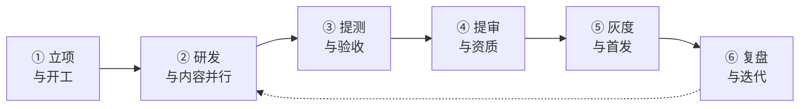

# 运营资产：上线计划与运营节奏
## 《星语人格 · 好友同频测试》配套资产

| 项目 | 内容 |
|---|---|
| 文档类型 | 上线计划与运营节奏（立项后、开工前） |
| 上游依据 | 《PRD-抖音趣味测试小游戏-星语人格.md》（1.4／7.1／7.2／7.3／8／9 章、10.3 执行顺序）；《合规资产-提审自检清单.md》；《测试资产-验收用例与测试计划.md》；《技术资产-研发侧技术方案预研.md》；《文案资产-达人引流素材规范.md》；《平台规则检索记录.md》（R-3～R-5、R-7） |
| 读者 | 产品 / 运营 / 商务运营 / 研发 / 法务 |
| 文档版本 | v1（提案稿） |

> **日期口径**：本文件**不写绝对日期**。绝对排期依赖研发人力与 D-1 / D-2 / D-3 / D-7 闭环时点，凡此类数值一律标注 `[TBD]`，由项目排期确定后回填。
>
> **本文件只定**「阶段、出口准则、门禁、节奏与责任」，不重复**技术实现（见技术资产）、测试方法（见测试资产）、提审材料与措辞（见合规资产）、达人脚本（见达人素材规范）**。

---

## 1. 上线路径与阶段划分

| 阶段 | 目标 | 出口准则（可判定） | 主责 | 外部依赖 |
|---|---|---|---|---|
| ① 立项与开工 | 交付物齐备、P0 项无遗留 | 汇报稿评审通过；PRD 10.1 四项 P0 确认项已回写；配套资产可按清单索引取用 | 产品 | — |
| ② 研发与内容并行 | 主流程可跑通、内容资产冻结 | 技术资产 12 章开工自检清单逐项通过；题库与 16 原型解读、5 档文案定稿冻结 | 研发 + 文案 | D-1（服务端载体） |
| ③ 提测与验收 | 功能、异常、并发全量验证通过 | 测试资产「提测门禁」通过；P0 / P1 缺陷清零 | 测试 | — |
| ④ 提审与资质 | 具备提交审核条件 | 测试资产「提审门禁」通过 + 提审自检清单逐项勾选 + 免责措辞与字库条款签核完成 | 产品 + 运营 + 法务 | D-2、D-5、D-6 |
| ⑤ 灰度与首发 | 小范围验证后正式投放 | 灰度观测窗口内无 P0 缺陷；埋点对账通过；观测指标无异常劣化 | 运营 + 研发 | D-7（广告准入） |
| ⑥ 复盘与迭代 | 目标值校准与问题闭环 | 首发满观察窗口完成指标校准并回写 PRD 第 9 章 | 产品 | D-4（首发数据） |

---

## 2. 里程碑与出口准则

| 里程碑 | 名称 | 出口准则（引用现有资产的判定项） |
|---|---|---|
| M1 | 立项通过 | 汇报稿评审通过；PRD 10.1 P0 四项已确认；无内部待补资产 |
| M2 | 研发自测通过 | 测试资产 2.1／2.2 单元用例全通过；**2¹⁰ 组合穷举门禁脚本无断言失败**；技术资产 12 章开工自检清单全勾选 |
| M3 | 提测通过 | 测试资产第 3 章集成与端到端、配对状态机并发幂等专项全通过；缺陷分级中 P0 / P1 清零 |
| M4 | 提审就绪 | 合规资产第二节四项前置条件完成；第七节截图清单 9 项材料齐备；免责措辞（D-5）与字库授权条款（D-6）签核冻结 |
| M5 | 首发放量 | 灰度窗口内无 P0；埋点 12 事件与三项指标换算对账通过；广告位合规验证（TC-CM-04 / 05）通过 |
| M6 | 首发复盘 | 满观察窗口后完成 6 项指标目标值校准（D-4），回写 PRD 第 9 章替换 `[TBD]` |

> **门槛判定规则**：任一里程碑的出口准则**存在未通过项即不得进入下一里程碑**，与测试资产第 8 章门禁清单同源，不得以经验判断放行。

---

## 3. 灰度与首发策略

| 项 | 安排 | 说明 |
|---|---|---|
| 灰度范围 | `[TBD]` | 建议先小流量池，规模与选样方式由运营确定 |
| 灰度观测窗口 | `[TBD]` | 建议覆盖至少一个完整自然周，以观察次留与复访（对齐 PRD 第 9 章「次留/复访」） |
| 首发载体 | 短视频挂载为主入口 + 达人推广任务为增长入口 | 与 PRD 7.1 一致；开通前置见第 4 章 |
| 回滚触发条件 | `[TBD]` | 建议以「提交失败率」「完测率骤降」「配对完成异常」三类信号定义阈值 |
| 放量节奏 | 灰度 → 小步放量 → 正式投放 | 每步以观测指标无劣化为前提 |

**首发期必看清单**
- 完测率（首要健康指标，PRD 第 9 章）不得出现异常劣化。
- 提交失败与配对失败有明确兜底（技术资产第 10 章异常矩阵）。
- 广告位按 PRD 7.3 展示，且**仅线上状态产生收益**（来源 R-5），首发准备期不预期收益。

---

## 4. 达人投放与内容节奏

> 素材口径与脚本约束见《文案资产-达人引流素材规范.md》，本节只定**节奏与前置**。

**三个阶段**

| 阶段 | 目标 | 达人层级侧重 | 内容方向 |
|---|---|---|---|
| 预热期 | 建立话题认知 | 中长尾为主 | 人格原型话题、符号卡视觉钩子 |
| 爆发期 | 冲量、放大配对互动 | 腰部 + 头部试点 | 「测试结果 + 拉闺蜜配对」过程型 |
| 长尾期 | 维持复访与复玩 | 长尾持续供给 | 不同好友的多次配对结果对比 |

**开通与结算前置（均为外部依赖，须闭环后方可投放）**

| 项 | 要求 | 来源 / 归属 |
|---|---|---|
| 达人推广挂载开通 | 小程序信用分 ≥ 60；主营类目符合开放类型；签署任务台推广协议 | R-4；D-2 关联 |
| 分成与结算细则 | 分成 = 开发者广告收益 × 达人分成比例；次月初生成结算单 | R-4；**D-3 待平台侧确认** |
| 投放预算 | `[TBD]` | 依赖 D-3 结算口径与投放规模决策 |

**内容合规（强制）**
- 达人素材、口播、封面、挂载文案**全部纳入禁用词与红线扫描范围**（PRD 4.3 / 8.3）。
- 达人侧不得出现封建迷信相关内容（来源 R-7）；素材上线前按达人素材规范的校验清单逐项确认。
- 不得使用强制分享、分享解锁、诱导裂变话术（PRD 7.2）。

---

## 5. 变现开通节奏

| 顺序 | 动作 | 前置条件 | 备注 |
|---|---|---|---|
| 1 | 申请开通流量主 | 无严重违规行为；同意广告组件服务协议 | 路径：控制台 → 设置 → 商业化变现（来源 R-5） |
| 2 | 上线激励视频位（自愿触发） | 小程序处于线上状态 | **未上线版本不产生收益**（R-5）；属 D-7 |
| 3 | 上线结果页原生广告位 | 同上 | 位置与结果卡保持可识别间距（PRD 7.3） |
| 4 | 广告合规验证 | 广告位展示后 | 按测试资产 TC-CM-04 / TC-CM-05 执行 |

- 虚拟内容变现为**不承诺项**，不纳入本期节奏（PRD 7.3）。
- 广告位按「可开关组件」设计，未开通时静默不渲染（技术资产风险表），故**开通时点不阻塞上线**。

---

## 6. 用户侧复玩与运营节奏

| 项 | 安排 | 依据 |
|---|---|---|
| 复玩钩子 | 原型固定、配对对象可变 → 鼓励对不同好友重复生成图谱 | PRD 1.4 可复玩 |
| 评论区 / 话题引导 | 仅使用推荐词（特质 / 偏好 / 原型 / 性格倾向 / 相处模式 / 气质意象） | PRD 4.3 |
| 禁止的运营动作 | 强制分享、分享解锁、以「预测 / 改运」为卖点或钩子 | PRD 7.2 / 8.3 / 达人素材规范 |
| 节点营销 | `[TBD]`，可选 | 须先过词表与红线扫描 |

---

## 7. 监控与告警

| 监控项 | 告警触发（阈值 `[TBD]`） | 主责 |
|---|---|---|
| 完测率 | 低于基线一定幅度 | 产品 + 数据 |
| 提交失败率 / 重试率 | 超过阈值 | 研发 |
| 配对发起率 / 完成率 | 异常跌降 | 产品 |
| 埋点上报成功率 | 低于阈值（含补传队列堆积） | 数据 |
| 广告曝光 / 完播 | 填充异常或为零（未开通时忽略） | 运营 |
| 包体积与启动耗时 | 超限或劣化 | 研发 |

- 阈值依赖首发数据校准（D-4），首发前仅建立监控项与采集口径，不预设数值。
- 值班与响应机制 `[TBD]`，由运营确定。

---

## 8. 复盘口径

**复盘时点**：首发满观察窗口（建议 ≥ 7 日，对齐 PRD 第 9 章与 D-4）。

**复盘输出（三件）**
1. **指标校准表**：6 项指标实测值与目标值 → 回写 PRD 第 9 章替换 `[TBD]`。
2. **问题清单**：按测试资产第 8 章缺陷分级归集，标注线上影响面。
3. **迭代输入**：进入下一轮 ② 阶段（研发与内容并行）。

**复盘必须回答的问题**
- 完测率是否达标；若未达标，主因在流程时长、首包体积还是答题交互（PRD 第 9 章验收口径补充）。
- 分享率与配对完成率是否形成有效裂变；分享卡视觉的点击表现是否影响结果（PRD 第 9 章）。
- 广告位合规性在真实投放后是否仍成立（TC-CM-04 / 05 线上复核）。

---

## 9. 上线前总门禁清单（跨资产汇总）

> 本节是全项目门禁的唯一汇总入口；各条目细节以对应资产为准，不在此重复展开。

| 门禁 | 判定依据 | 通过标准 |
|---|---|---|
| 内容与材料 | 《合规资产-提审自检清单.md》第二、三、四、七、八节 | 全部勾选；红线速查无「是」项；截图材料齐备 |
| 功能与异常 | 《测试资产-验收用例与测试计划.md》第 2、3 章 | 单元 + 集成 + 状态机专项全通过 |
| 红线实现层 | 《测试资产-验收用例与测试计划.md》第 7 章 12 项 | 全通过，与提审清单交叉复核一致 |
| 兼容与性能 | 《测试资产-验收用例与测试计划.md》第 4、5 章 | 矩阵覆盖；阈值达标（`[TBD]`） |
| 埋点与指标 | 《测试资产-验收用例与测试计划.md》第 6 章 | 事件无漏报；换算口径对账一致 |
| 技术就绪 | 《技术资产-研发侧技术方案预研.md》第 12 章 | 开工自检清单全勾选；无实现副本 |
| 外部依赖 | 《待确认项台账-外部依赖确认单.md》 | 上线前须闭环项（D-2 / D-5 / D-6 / D-7）全部确认 |

---

## 10. 待确认项与风险

| 编号 | 影响本文件的条目 | 阻塞的里程碑 |
|---|---|---|
| D-1 | 服务端载体、机型与系统最低支持版本、埋点上报通道 | ② 研发与内容并行 |
| D-2 | 类目与资质、达人推广挂载开通资格 | ④ 提审与资质、达人投放 |
| D-3 | 达人推广挂载分成与结算细则 | 达人投放预算与排期 |
| D-4 | 6 项指标目标值与告警阈值 | ⑦ 监控告警设置、⑧ 复盘校准 |
| D-5 | 免责措辞法务签核 | ④ 提审就绪（硬性门禁） |
| D-6 | 字库授权条款 | ④ 提审就绪（硬性门禁） |
| D-7 | 广告变现准入与开通时点 | ⑤ 首发后的变现验证（不阻塞上线） |

**已可确定的节奏要素（无需外部依赖）**：阶段划分与里程碑序列、各里程碑出口准则、上线前总门禁清单、复玩与合规运营边界、复盘的三件输出物。

**风险提示**：本文件的绝对排期、灰度规模、告警阈值与投放预算均为 `[TBD]`，任何对外排期承诺须在 D-1～D-7 相应条目闭环后再行给出。

---

## 11. 自检：本文件的完成度

- [x] 阶段划分与里程碑出口准则可判定，且逐项指向既有资产的验收结论（不重复造标准）。
- [x] 全程未写绝对日期、未臆造规模、阈值与预算，均标 `[TBD]`。
- [x] 达人投放、变现开通、合规运营三处的前置条件与平台规则来源编号一致（R-3～R-5、R-7）。
- [x] 上线前总门禁清单汇聚全项目门禁，无遗漏、无与上游资产冲突的判定标准。
- [x] 复盘口径与 D-4 校准、PRD 第 9 章回写形成闭环。
- [ ] `[TBD]` 条目待 D-1～D-7 闭环后回填。

---

*本文档为 v1（提案稿）。上游口径以《PRD-抖音趣味测试小游戏-星语人格.md》为准（章节引用不随 PRD 版本号变更）。本文件不写绝对日期，不预设灰度规模与告警阈值；排期与阈值须在外部依赖闭环后确定。*
